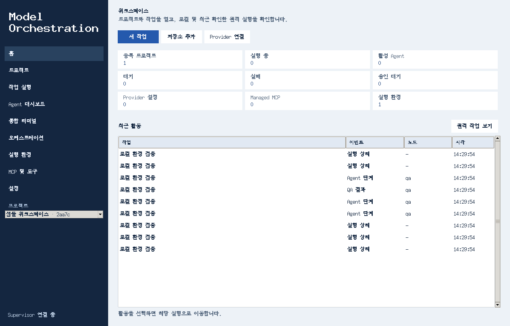

# Model Orchestration

<div align="center">
  
</div>

[한국어](README.md) · **English**

A Windows desktop workspace for Agent runs, independent review, integration QA, and merge approval across local and SSH Git projects.


[Getting started](docs/en/user-guide/getting-started.md) · [Documentation](docs/en/index.md) · [Troubleshooting](docs/en/troubleshooting/index.md)

## Screenshot



The running workspace, captured on a Linux virtual display with a sample repository and an actual QA run.

## Key features

| Feature | What you can do |
| --- | --- |
| Projects and plans | Save project defaults and review task plans generated from a description and execution strategy. |
| Providers and models | Register local runtimes and trusted CLI routes in the wizard. Check runtime connections and model lists. |
| Terminal and SSH | Use integrated PTYs, pinned SSH host profiles, and reconnect to Linux Worker jobs. |
| MCP | Discover CLI configurations and allow tools for Managed jobs. Migrate supported OpenCode JSON and Codex TOML bindings to the Gateway and roll them back. |
| Multi-Agent Orchestration | Define DAG nodes by role. The Supervisor runs eligible tasks in individual Git Worktrees. |
| Managed Harness | Probe effective Context and tool calling, then enforce file scopes, repetition limits, checkpoints, and approval for external writes. |
| Background Execution | Let opted-in jobs continue under the Supervisor after you close the app. Expired job leases can be recovered on restart. |
| Git verification | Review the candidate SHA after integration QA and approve a fast-forward into the local target branch. |

## Architecture

The Tkinter desktop and a separate Python Supervisor share a local SQLite database for jobs, states, and events. The Supervisor selects a Model and Harness and runs tasks in Git Worktrees. The dashboard and exported JSON report show the outcome. [Architecture and execution flow](docs/en/developer-guide/architecture.md)

## Installation and quick start

1. Install Git for Windows and Python 3.11 or later on Windows 10/11, including Tcl/Tk and the Python Launcher. Confirm that `git --version` works in a terminal.
2. Obtain the repository source and run [Launch-Windows.cmd](Launch-Windows.cmd). Without the launcher, open [ModelOrchestration.pyw](ModelOrchestration.pyw) with `pythonw.exe`.
3. Add a repository under **Projects** and register a model under **Settings → Provider setup wizard**.
4. Use **New task → Create a plan** to enter a request. See the [workspace guide](docs/en/user-guide/workspace.md) for SSH, terminal dependencies and model-free QA.

Install Model files, external Runtimes, and CLIs separately. For a Windows executable built from source, see [Testing and builds](docs/en/developer-guide/testing.md).

## Documentation

| Guide | Topics |
| --- | --- |
| User | [Providers and models](docs/en/user-guide/providers.md), [MCP](docs/en/user-guide/mcp.md), [Running jobs](docs/en/user-guide/orchestration.md), [Managed Harness](docs/en/user-guide/managed-harness.md), [Background Execution](docs/en/user-guide/background.md) |
| Administrator | [Operations, credentials, resources, and backups](docs/en/admin-guide/operations.md), [Configuration and API](docs/en/admin-guide/configuration.md) |
| Developer | [Architecture](docs/en/developer-guide/architecture.md), [Testing and builds](docs/en/developer-guide/testing.md), [Documentation maintenance](docs/en/developer-guide/documentation.md) |
| Support | [Troubleshooting](docs/en/troubleshooting/index.md), [FAQ](docs/en/faq.md), [Roadmap](docs/en/roadmap.md) |

## Development and contributions

```bash
python -m unittest discover -s tests -v
```

The suite uses temporary Git repositories and loopback fixtures. See the [contribution guide](CONTRIBUTING.en.md) for site preview and validation commands and [CHANGELOG.md](CHANGELOG.md) for the change history.

With Node.js 24, run `npm ci` and `npm run verify -- --core-only` to check the portable TypeScript policies. `npm run verify -- --ui --package` uses the same entry point on Linux and Windows. The Electron dashboard reads existing work; the Python Supervisor runs jobs, handles approvals, and recovers state. [Platform verification and compatibility](docs/internal/cross-platform-architecture.md)

## Roadmap

See the [roadmap](docs/en/roadmap.md) for distributed DAGs, a Windows Worker and additional provider adapters.

## License

The maintainers have not published a project license. [License status](LICENSE)
