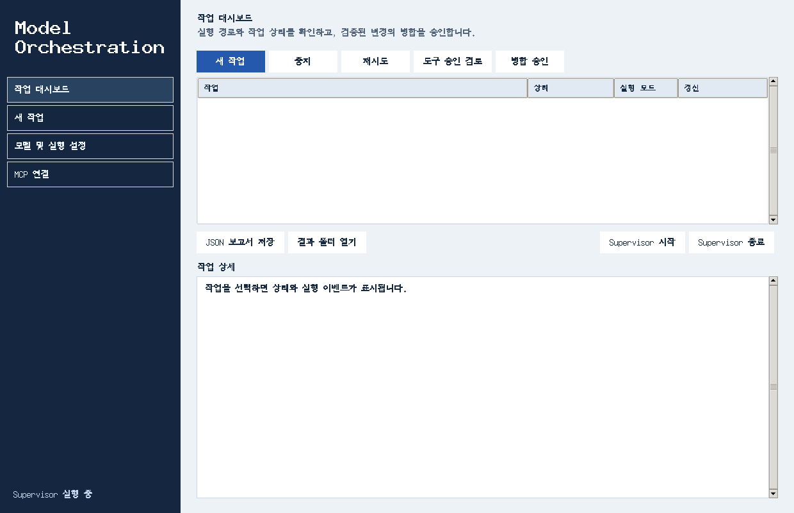

# Model Orchestration

<div align="center">
  
</div>

**한국어** · [English](README.en.md)

로컬 Git 저장소의 작업을 DAG로 나누고, Agent 실행부터 독립 검토, 통합 QA, 병합 승인까지 한 화면에서 관리하는 Windows 데스크톱 앱입니다.


[시작하기](docs/ko/user-guide/getting-started.md) · [문서 홈](docs/ko/index.md) · [문제 해결](docs/ko/troubleshooting/index.md)

## 스크린샷



빈 데이터 폴더로 실행한 실제 Tkinter 화면입니다. Linux 가상 디스플레이에서 캡처했으며 Windows에서는 글꼴과 창 테두리가 다를 수 있습니다.

## 주요 기능

| 기능 | 사용 범위 |
| --- | --- |
| Provider 및 Model | 앱의 JSON 편집기에서 로컬 Runtime과 신뢰하는 CLI 경로를 등록하고, 작업에서 Model 및 Harness를 지정합니다. |
| MCP | CLI 설정을 탐색하고 Managed 작업에 도구를 허용합니다. 지원되는 OpenCode JSON과 Codex TOML 연결은 Gateway로 전환하고 롤백할 수 있습니다. |
| Multi-Agent Orchestration | 역할별 DAG 노드를 등록합니다. Supervisor가 의존성이 충족된 작업을 각각의 Git Worktree에서 실행합니다. |
| Managed Harness | 실제 Context와 도구 호출 능력을 검사하고, 파일 범위, 반복 한도, 체크포인트 및 외부 쓰기 승인을 적용합니다. |
| Background Execution | 켜 둔 작업은 UI를 닫아도 별도 Supervisor에서 계속 실행됩니다. 만료된 작업 임대는 재기동 후 복구할 수 있습니다. |
| Git 검증 | 통합 QA를 통과한 후보 SHA를 사용자가 승인하면 대상 로컬 브랜치에 fast-forward로 반영합니다. |

## 아키텍처

Tkinter Desktop과 별도 Python Supervisor는 로컬 SQLite에 작업, 상태, 이벤트를 기록합니다. Supervisor는 Model과 Harness를 선택하고 Git Worktree에서 노드를 실행합니다. 결과는 대시보드와 JSON 보고서로 확인합니다. [아키텍처와 실행 흐름](docs/ko/developer-guide/architecture.md)

## 설치 및 빠른 시작

1. Windows 10/11에 Git for Windows와 Python 3.11 이상을 설치합니다. Python 설치에서 Tcl/Tk와 Python Launcher를 포함하고, 터미널에서 `git --version`이 동작하는지 확인합니다.
2. 저장소 소스를 받은 뒤 [Launch-Windows.cmd](Launch-Windows.cmd)를 실행합니다. Python Launcher 없이 실행하려면 `pythonw.exe`로 [ModelOrchestration.pyw](ModelOrchestration.pyw)를 엽니다.
3. **모델 및 실행 설정 → JSON 가져오기**에서 [Windows 레지스트리 예제](examples/registry.windows.json)를 엽니다. 설치한 Runtime과 Model의 실제 경로를 지정한 뒤 **설정 저장**을 누릅니다.
4. **새 작업**에서 Git 저장소와 대상 브랜치를 선택하고 작업을 제출합니다. 첫 읽기 전용 실행과 Model 없이 하는 스모크 테스트도 [시작하기](docs/ko/user-guide/getting-started.md)에 있습니다.

Model 파일, 외부 Runtime 및 CLI는 별도로 설치합니다. Windows용 실행 파일을 소스에서 만드는 방법은 [테스트와 빌드](docs/ko/developer-guide/testing.md)를 참고하세요.

## 문서

| 가이드 | 내용 |
| --- | --- |
| 사용자 | [Provider 및 Model](docs/ko/user-guide/providers.md), [MCP](docs/ko/user-guide/mcp.md), [작업 실행](docs/ko/user-guide/orchestration.md), [Managed Harness](docs/ko/user-guide/managed-harness.md), [Background Execution](docs/ko/user-guide/background.md) |
| 관리자 | [운영 환경, 자격 증명, 리소스 및 백업](docs/ko/admin-guide/operations.md), [설정 및 API](docs/ko/admin-guide/configuration.md) |
| 개발자 | [아키텍처](docs/ko/developer-guide/architecture.md), [테스트와 빌드](docs/ko/developer-guide/testing.md), [문서 관리](docs/ko/developer-guide/documentation.md) |
| 지원 | [문제 해결](docs/ko/troubleshooting/index.md), [자주 묻는 질문](docs/ko/faq.md), [로드맵](docs/ko/roadmap.md) |

## 개발 및 기여

```bash
python -m unittest discover -s tests -v
```

테스트는 임시 Git 저장소와 loopback 모의 서버를 사용합니다. 문서 사이트 미리 보기와 검증 명령은 [기여 가이드](CONTRIBUTING.md)에 있습니다. 변경 이력은 [CHANGELOG.md](CHANGELOG.md)를 확인하세요.

## 로드맵

SSH/Remote Execution, GUI 언어 선택과 도움말 연결, 양식 기반 Provider 설정은 [로드맵](docs/ko/roadmap.md)의 미구현 범위에 있습니다.

## 라이선스

저장소 관리자가 공개한 프로젝트 라이선스가 없습니다. [라이선스 현황](LICENSE)
