# Architecture

## Application lifecycle

`ModelOrchestration.pyw` starts the Tkinter desktop by default, or just the Supervisor with `--supervisor`. `orchestra/desktop.py` handles input, approvals, and status. The desktop regularly records client presence in the Store and starts the separate Supervisor process as needed. `supervisor.py` uses a lock in the data directory to prevent duplicate owners.

[Mermaid](../../assets/diagrams/architecture.en.mmd)

## Agent Runtime and Providers

`config_check` and `plan_check` in `core.py` validate the registry and DAG. `runtime.py` filters and ranks routes and handles Runtime reservation, startup, and cleanup. Model adapters share an OpenAI-compatible chat interface. To observe effective Context, they read llama.cpp's `/props`, Ollama's `/api/ps`, or the OpenAI-compatible `/v1/models`. Snapshot events record desired, observed, and validated settings.

`Managed` in `harness.py` handles file tools, MCP schemas, external write approvals, Context compaction, and budgets. `attached` launches a separate CLI and extracts output and usage from JSON events. It generates different temporary configurations for OpenCode 1.x and 2.x. Codex uses read-only noninteractive execution. Internal CLI state is only partially observable.

## Multi-Agent scheduling and Git

`ordered` in `supervisor.py` computes topological order and transitive dependencies. `JobRunner` submits nodes whose dependencies succeeded, up to the concurrency limit. `gitgate.py` pins the base SHA and applies dependency commits to each node's Worktree. It validates changed paths and Git modes, runs QA in the integration Worktree, and records the candidate SHA. A per-repository lock and Git fast-forward checks serialize approved merges.

## MCP integration

`discovery.py` inspects known CLI configuration paths for scope, fingerprints, and conflicts. The Managed Harness obtains tool catalogs through HTTP and stdio clients in `mcp.py`, then filters by role, name, and supported JSON schema. It records the start and completion of external writes. The loopback Gateway checks tokens and serves read-only tools. Binding migration uses configuration verification and byte-for-byte backups.

## Background Execution, Session, and Context

`store.py` manages jobs, nodes, events, approvals, and calls in SQLite with WAL. The Supervisor claims jobs and renews heartbeats. Following a crash, work held by a previous owner is handled after lease expiry. Background nodes can continue from checkpoints, while foreground nodes require live client presence.

Managed checkpoints contain the current step, route, messages, pending calls, and tool fingerprint. Completed external write results can be reused. Writes with uncertain outcomes block replay. An interrupted Attached CLI has more limited recovery. See [Operations](../admin-guide/operations.md) for what is persisted and exported.

## Workspace and execution environments

`workspace_desktop.py` extends the original desktop's run and approval paths with projects, guided plans, Agents, and terminals. Forms call services in `workspace.py` and the original validators. Operator terminals use independent PTYs, while Agent reporting reads Supervisor events. Linux `remote.py` accepts a narrow OpenSSH protocol and delegates execution to the existing Supervisor on the server. SQLite maps the remote request ID to the job transactionally, so reconnecting can find the same execution. [Setup and security](../user-guide/workspace.md)

Tk is the primary operator app for projects, Provider profiles, plans, terminals, and approvals. The Electron preview is a companion for execution history and QA evidence. Its versioned, read-only SQLite and IPC contracts let both apps use the same data directory while Python owns writes and recovery. Any future promotion of Electron requires equivalent operator workflows against the Python authority and native verification. [Release readiness assessment](https://github.com/djsk721/full-orchestration/blob/main/docs/internal/release-readiness.md)
