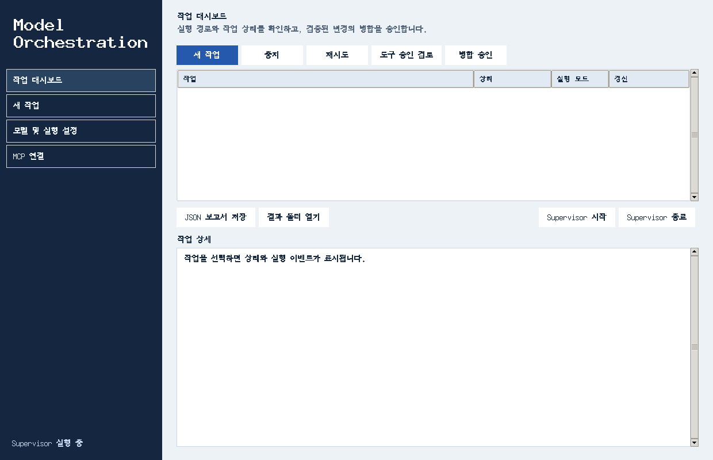

# Model Orchestration

Model Orchestration is a Windows desktop app for defining task dependencies and running Agents and QA in local Git repositories. The dashboard shows execution routes and job events.

## Get started

- Follow [Getting started](user-guide/getting-started.md) to install the app, load the examples, and run your first job.
- If you already have a model, connect its Runtime in [Providers and models](user-guide/providers.md).
- See [Running jobs](user-guide/orchestration.md) for task dependencies and merge approval.

## Operate and develop

- [Operations](admin-guide/operations.md) covers credentials, resources, logs, and backups.
- [Architecture](developer-guide/architecture.md) describes how the desktop, Supervisor, SQLite, Harnesses, and Git interact.
- Consult [Troubleshooting](troubleshooting/index.md) for failures and the [Roadmap](roadmap.md) for capability limits.
