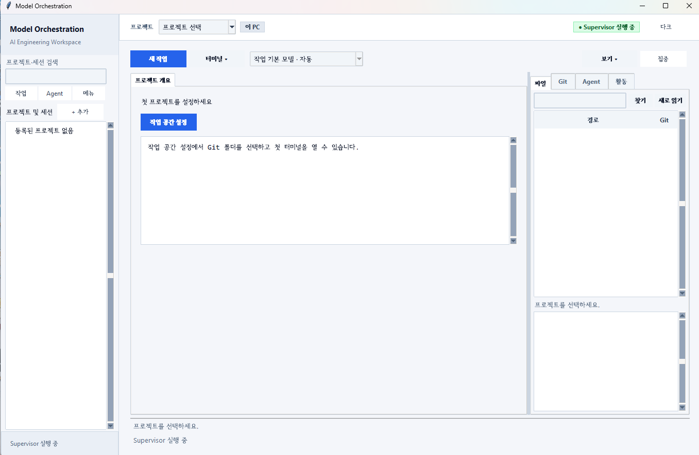

# Windows desktop UI, Korean IME and display scaling

**Interactive acceptance NOT VERIFIED.** The operator's Windows screenshot establishes PASS for main window rendering. The operator reports launching through Python. Scale and application revision are unknown. CI measured 96 DPI and automated Unicode clipboard transfer, splits, resizing and layout restoration with fixtures. Native IME requires direct composition with the keyboard.

The original 1357 × 885 capture shows the Korean idle Workspace. At that window size the primary toolbar, project panel, context tabs and footer are visible. The screenshot records the `Supervisor 실행 중` indicator. SQLite history, the actual Supervisor process, tab interaction and display scale remain unverified. The original PNG SHA-256 is `f493a146190d25c0e67cb56f3229bc294160d1b8e4d0f5893b52f732c10dc47a`.

## Capture the workspace at each scale

Use the isolated Windows test profile and the [per-scale smoke commands](windows-native-ux-validation.md#repeat-the-gui-checks-at-each-display-scale). Keep the same test monitor and screen resolution. Restart the app after setting each scale in Windows display settings. Record the Windows build, desktop mode, source revision or installer SHA-256, and screenshot dimensions. Use separate directories for source and installed evidence.

| Display scale | Expected DPI | Source/manual | NSIS/manual | Screenshot and log |
| --- | ---: | --- | --- | --- |
| 100% | 96 | NOT VERIFIED | NOT VERIFIED | Awaiting capture |
| 125% | 120 | NOT VERIFIED | NOT VERIFIED | Awaiting capture |
| 150% | 144 | NOT VERIFIED | NOT VERIFIED | Awaiting capture |

At each scale, run these checks with a disposable project.

1. Start Tk, verify the Supervisor status becomes active, open History to confirm SQLite-backed data renders, and open a local shell. Expand the project and session trees, switch tabs, toggle Focus, and show and hide the context panel. Switch dark/light theme and resize the app from a comfortable width to the minimum supported layout.
2. Open the model selector, task, Provider and SSH forms. Check tab overflow, button visibility, wrapped labels, sidebar width, font rendering, dialog positions and focus after closing each dialog. Check the terminal when changing split direction and dragging the divider.
3. Switch to Microsoft Korean IME and type `한글 입력` in project search, task title/description, Provider display fields, SSH display name, another dialog field and both terminal panes. Use dummy values and dismiss unsaved settings forms. Capture composition and the committed result for each field. Check the caret after a composition, candidate placement and focus switching during composition.
4. In both local PowerShell panes, type and commit `Write-Output '한글 입력'` and run it. Capture the exact echoed text, compare clipboard copy/paste, and confirm only the focused pane received the input.
5. Leave a split layout, a visible context pane and the active project selected. Capture the window, close it normally, then reopen with the same isolated profile. Compare sash position, tabs, context state and session placeholders. Confirm the saved layout does not launch old commands. Capture the reopened view.

For a failed check, retain the exact steps, OS build, scale, active input mode, source or installed build identity, observed behavior and a focused capture. Record clipboard and IME outcomes separately.
