# 아키텍처

## 애플리케이션 수명 주기

`ModelOrchestration.pyw`는 기본으로 Tkinter Desktop을 시작하고, `--supervisor`가 있으면 Supervisor만 시작합니다. `orchestra/desktop.py`는 입력·승인·상태 표시를 맡습니다. Desktop은 Store에 주기적으로 사용자 세션의 존재를 기록하며 필요할 때 별도 프로세스로 Supervisor를 시작합니다. `supervisor.py`는 데이터 폴더의 프로세스 잠금으로 중복 실행을 방지합니다.

[Mermaid](../../assets/diagrams/architecture.ko.mmd)

## Agent Runtime 및 Provider

`core.py`의 `config_check`와 `plan_check`가 레지스트리와 DAG를 검증합니다. `runtime.py`는 후보를 필터링하고 순위를 매기며, Runtime 예약·시작·정리를 관리합니다. Model 어댑터는 OpenAI 호환 채팅 인터페이스를 공유하며 Runtime별로 llama.cpp `/props`, Ollama `/api/ps`, OpenAI 호환 `/v1/models`에서 유효 Context를 관측합니다. 구성과 관측 및 검증 값은 스냅샷 이벤트로 남습니다.

`harness.py`의 `Managed`는 파일 도구, MCP 스키마, 외부 쓰기 승인, Context 압축과 예산을 관리합니다. `attached`는 별도 CLI 프로세스를 실행하고 JSON 이벤트에서 결과와 사용량을 추출합니다. OpenCode 1.x와 2.x에 각각 임시 구성 형식을 생성합니다. Codex는 읽기 전용 비대화형 실행입니다. CLI 내부 설정은 관측 한계가 있습니다.

## Multi-Agent 스케줄링과 Git

`supervisor.py`의 `ordered`가 위상 순서와 전이 의존성을 계산합니다. `JobRunner`는 모든 선행 작업이 성공한 노드를 동시성 한도 내에서 실행합니다. `gitgate.py`는 기준 SHA를 고정하고 노드 Worktree에 선행 커밋을 적용합니다. 변경 경로와 Git 모드를 검사하고, 통합 Worktree에서 QA를 실행한 뒤 후보 SHA를 저장합니다. 승인 적용은 저장소별 잠금과 Git fast-forward 검사로 직렬화합니다.

## MCP 통합

`discovery.py`는 알려진 CLI 설정의 범위, 원본 지문과 충돌 후보를 읽습니다. Managed Harness는 `mcp.py`의 HTTP/stdio 클라이언트에서 도구 목록을 가져온 뒤 역할, 이름 및 지원되는 JSON 스키마로 필터링합니다. 외부 쓰기는 호출 시작과 완료를 영속화합니다. loopback Gateway는 토큰을 확인하고 읽기 정책을 적용합니다. 설정 전환은 새 파일 검증과 원본 백업으로 보호합니다.

## Background Execution, Session 및 Context

`store.py`는 WAL을 쓰는 SQLite의 작업·노드·이벤트·승인·호출 테이블을 관리합니다. Supervisor는 대기 작업을 점유하고 하트비트를 갱신합니다. 비정상 종료 뒤 소유자가 다른 작업은 임대 만료 시 처리합니다. 백그라운드 노드는 체크포인트에서 이어질 수 있으며 포그라운드는 활성 세션이 필요합니다.

Managed 체크포인트에는 진행 단계, 경로, 메시지, 대기 호출 및 도구 지문이 포함됩니다. 완료된 외부 쓰기 결과를 재사용하고 완료가 불명확한 쓰기는 재호출하지 않습니다. 실행 도중 끊긴 Attached CLI에는 같은 재생 보장이 없습니다. 보고서와 원본 데이터의 차이는 [운영 환경](../admin-guide/operations.md)에 정리했습니다.

## 워크스페이스와 실행 환경

`workspace_desktop.py`는 기존 Desktop의 실행 및 승인 화면을 유지하면서 프로젝트·계획·Agent·터미널 화면을 추가합니다. 구조화된 양식은 `workspace.py`의 서비스와 기존 검증기에 연결합니다. 터미널은 독립 PTY이고 Agent는 Supervisor의 구조화 이벤트로 연결됩니다. Linux `remote.py`는 OpenSSH를 통한 제한된 요청을 받으며 실행은 서버의 기존 Supervisor에 위임합니다. 원격 요청 ID와 실제 작업을 SQLite 트랜잭션으로 연결하고 사용자 재연결로 같은 실행을 조회합니다. [설치·보안 및 운영](../user-guide/workspace.md)
