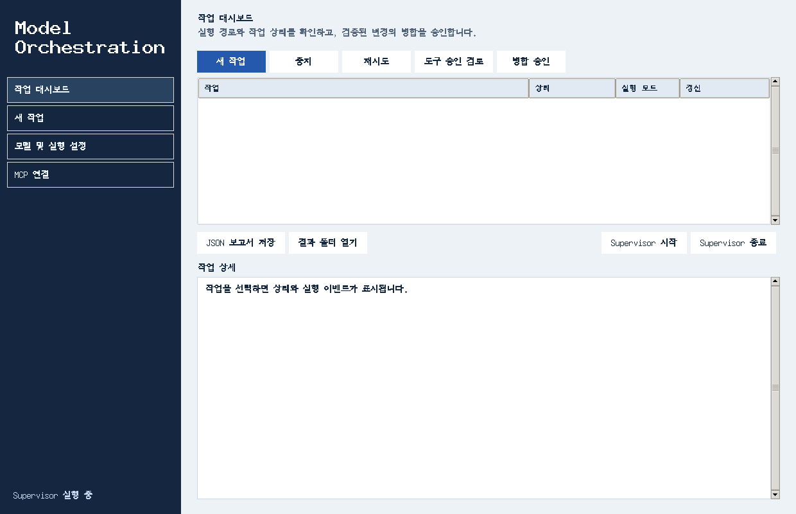

# Model Orchestration

Windows의 로컬 Git 저장소에서 작업 의존성을 정의하고 Agent와 QA를 실행하는 데스크톱 앱입니다. 실행 경로와 작업 이벤트를 대시보드에서 확인할 수 있습니다.

## 시작 경로

- 설치, 샘플 등록, 첫 실행은 [시작하기](user-guide/getting-started.md)를 따르세요.
- 이미 모델이 있다면 [Provider 및 Model](user-guide/providers.md)에서 Runtime을 연결하세요.
- 여러 작업의 선후 관계와 병합 승인 절차는 [작업 실행](user-guide/orchestration.md)에 있습니다.

## 운영 및 개발

- [운영 환경](admin-guide/operations.md)은 자격 증명, 리소스, 로그 및 백업을 다룹니다.
- [아키텍처](developer-guide/architecture.md)는 Desktop, Supervisor, SQLite, Harness, Git 간 경계를 설명합니다.
- [문제 해결](troubleshooting/index.md)과 [로드맵](roadmap.md)에서 오류와 기능 범위를 확인하세요.
